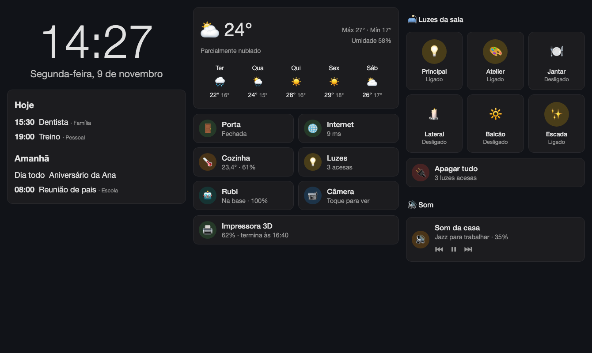
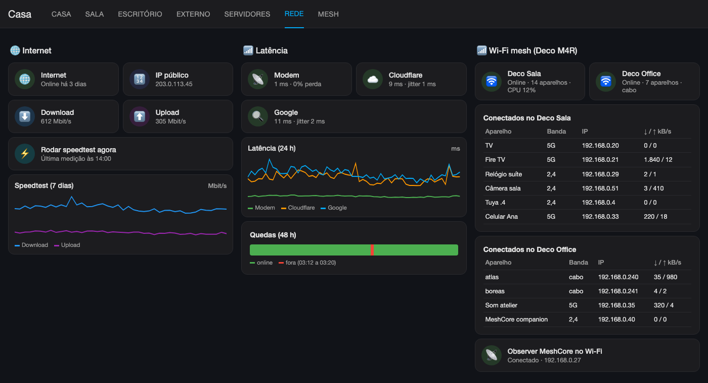

# Casa inteligente com Home Assistant

🇺🇸 [English](../README.md) · 🇧🇷 Português

Guia de como montei o Home Assistant da casa: instalação em Docker, integrações, painéis (inclusive um painel de tablet estilo Echo Show), monitoramento da rede, MeshCore e um bot do Telegram com alertas e comandos.

A ideia é que outra pessoa consiga seguir os passos e montar algo parecido.

**Nomes de servidores, IPs (rede 192.168.0.0/24), domínio (`example.com`), chaves e IDs são fictícios.** A estrutura, as integrações e o código são os reais. Troque pelos seus valores antes de rodar os scripts.

Comece pelo [inventário](docs/00-inventario.md): a lista do que existe na rede e o que foi integrado.

Mais exemplos em [Painéis](docs/08-paineis.md). As imagens são maquetes com dados fictícios.

## O que tem aqui

| Pasta | Conteúdo |
|---|---|
| `PT-BR/docs/` | Guias passo a passo, na ordem em que foram feitos |
| `docs/img/` | Imagens de exemplo dos painéis (compartilhadas com a versão em inglês) |
| `scripts/` | Scripts Python (na raiz do repositório) que criam integrações, renomeiam entidades e geram painéis e automações pela API |
| `config/` | Na raiz do repositório: trechos de `configuration.yaml` e o `compose.yaml` |

## Roteiro

0. [Inventário](docs/00-inventario.md): aparelhos, integrações, sensores, automações e painéis.
1. [Instalação](docs/01-instalacao.md): Docker no ZimaOS/CasaOS, proxy reverso com Traefik e primeiro acesso.
2. [Acesso pela API](docs/02-api-e-scripts.md): token, WebSocket, REST e como rodar os scripts.
3. [Integrações](docs/03-integracoes.md): Tuya, Cast, OctoPrint, servidores, Pi-hole, Plex, Google, backup, Marketplace.
4. [Energia](docs/04-energia.md): consumo e custo em R$ de uma tomada Tuya, com histórico importado.
5. [Rede](docs/05-rede.md): internet (ping, speedtest, IP público) e Wi-Fi mesh TP-Link Deco.
6. [MeshCore](docs/06-meshcore.md): companion LoRa, repetidor e dados públicos do CoreScope.
7. [Sensores de template](docs/07-sensores-template.md): agenda, chuva chegando, diário da noite, mensagens do mesh.
8. [Painéis](docs/08-paineis.md): painel principal com 7 abas e painel "Central" para tablet.
9. [Bot do Telegram](docs/09-telegram.md): criação do bot, alertas, botões e comandos.
10. [Pegadinhas](docs/10-pegadinhas.md): erros que apareceram e como resolvi.

## Ambiente

| Item | Valor no meu caso |
|---|---|
| Servidor | `atlas`, ZimaOS (CasaOS), IP fixo 192.168.0.240 |
| Home Assistant | Container `ghcr.io/home-assistant/home-assistant:stable` (2026.11) |
| Acesso | `https://ha.example.com` via Traefik, só LAN e Tailscale |
| Segundo servidor | `boreas`, Ubuntu, 192.168.0.241 (Glances, Docker de testes) |
| Rede | Modem da operadora 192.168.0.1 + 2 TP-Link Deco M4R (192.168.0.10 e .13) |

## Regras que segui

- Senhas e tokens são digitados só na interface do HA, nunca colados em chat, script ou repositório.
- O token de API fica em um arquivo com permissão 700 fora da pasta de config.
- Antes de mexer no `configuration.yaml` ou no `automations.yaml`, faço uma cópia `.bak-<assunto>`.
- Todo script tem versão no cabeçalho, e a versão sobe a cada mudança.
- Nada de expor o HA direto na internet: o acesso remoto é pelo Tailscale.
