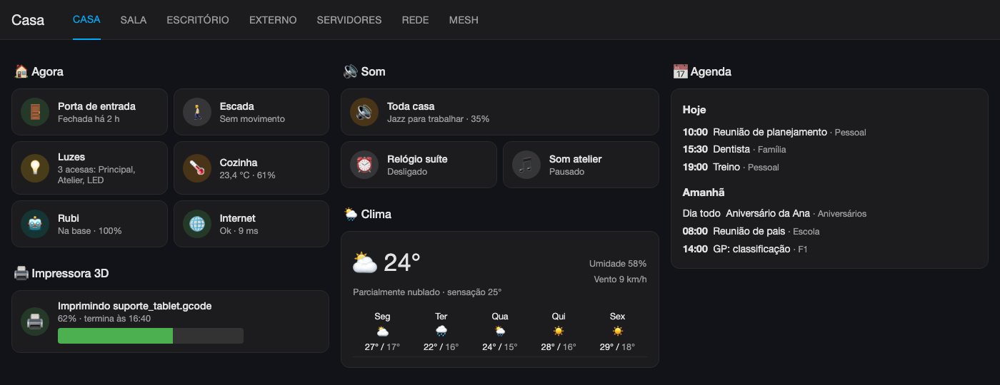
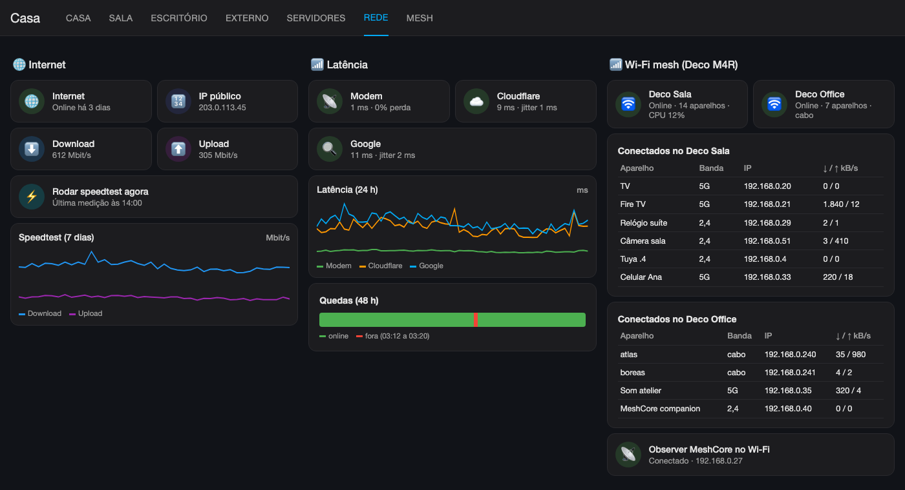
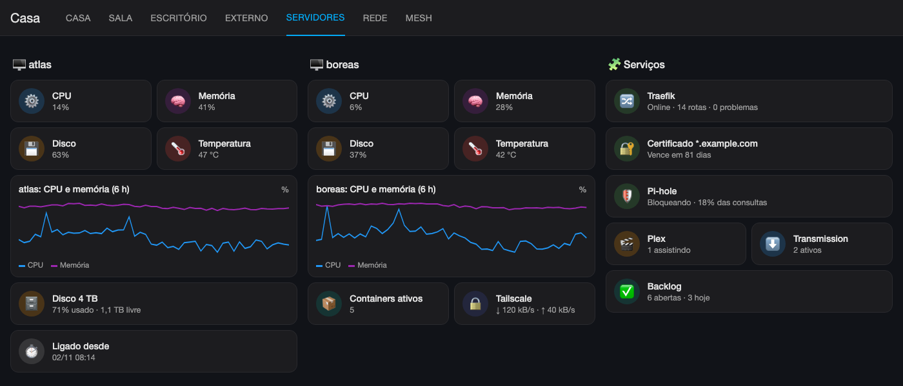
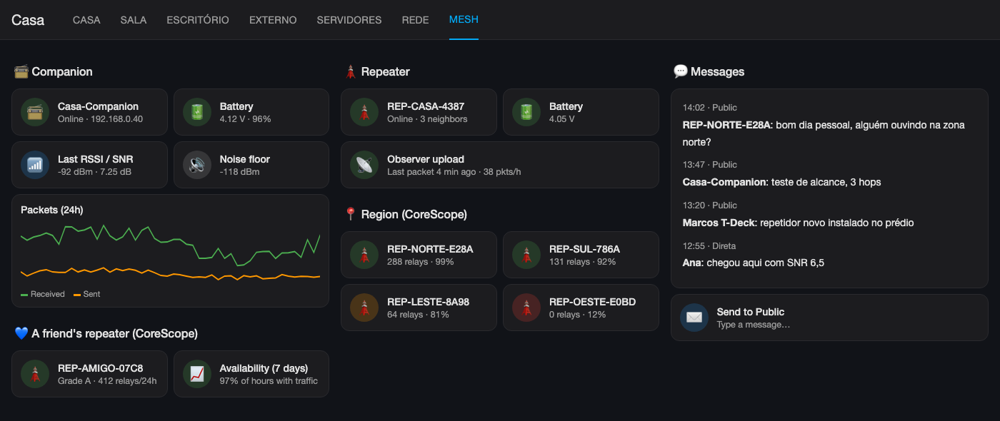
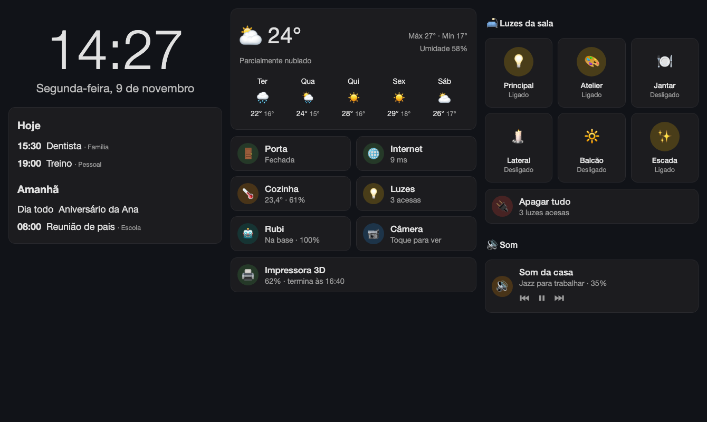

# 8. Painéis

Os dois painéis são gerados por script em Python. O script monta o JSON do Lovelace e grava com `lovelace/config/save`. Assim o painel inteiro fica versionado. **Não edite pela interface**: a próxima execução do script sobrescreve as mudanças.

```bash
# primeira vez (cria o painel)
{ cat ../ha_token; echo; python3 painel_casa.py --create; } | docker exec -i homeassistant python3 -c "$(cat ha_ws.py)"
# depois (só atualiza)
{ cat ../ha_token; echo; python3 painel_casa.py; } | docker exec -i homeassistant python3 -c "$(cat ha_ws.py)"
```

Pré-requisitos (Marketplace): Mushroom, mini-graph-card e card-mod.

## 8.1 Painel "Casa" (`painel-casa`, `painel_casa.py`)

As abas usam o tipo `sections`:

| Aba | Conteúdo |
|---|---|
| Casa | "Agora" (porta, movimento na escada, luzes acesas), impressora 3D, som (toda casa, suíte, atelier), clima, agenda (`calendar` listWeek) |
| Sala | Câmera, ambiente (temperatura e umidade), luzes, controle IR (cenas), Rubi com botões de pausar, retomar e parar |
| Escritório | Setup (tomada, potência, consumo e custo, preço do kWh), Stacklog, luzes, impressora 3D, histórico de consumo por mês |
| Externo | Luzes do quintal, porta de entrada (estado e bateria), clima |
| Servidores | atlas e boreas (CPU, memória, disco, rede), Traefik, Pi-hole, Plex, Transmission |
| Rede | Internet (status, IP público, speedtest), latência 24 h, quedas 48 h, Decos com a lista de conectados, tráfego |
| Mesh | Resumo do meu repetidor, do repetidor de um amigo e do companion. Fica em inglês (como as outras abas de mesh) para mostrar para a comunidade |
| Region, Capital, Abroad | Uma aba por grupo de repetidoras da comunidade (CoreScope): tabela de comparação e gráfico de 7 dias em cima, depois um card curto por repetidora |
| Messages | Envio de mensagem, minhas últimas mensagens, canal Public da rede inteira |
| Abroad chat | Dois canais de outro CoreScope (um canal hashtag local e o Public) |

Dicas do script:

- As funções `tpl()`, `tile()`, `luz()`, `graf()` e `sec()` evitam repetir JSON.
- Cards usados em mais de uma aba precisam ser definidos **antes** da primeira aba que usa, senão dá `NameError`.
- Antes de publicar, confira se as entidades existem e renderize os templates com `/api/template`.

A lista de conectados de cada Deco é um card markdown que percorre os `device_tracker.wifi_*` com `attributes.deco_device == 'Sala'`.

### Abas de mesh: resumo mais página de detalhes

A primeira versão mostrava cada contador como um tile, e as abas viraram uma parede de cards. Agora cada aba de mesh mostra só um resumo, e o resto fica numa **subview**:

- **Resumo** (`resumo_repetidor`, `resumo_companion`, `resumo_cs()`): um card de status, 4 números grandes numa linha (`kpi()`, card mushroom com `layout: vertical`, 3 colunas cada), uma ou duas linhas que juntam vários valores (`linha()`, Ex: "130 sent · 137 received · 7 errors · airtime 0.1%"), um gráfico e o link **All details** (`detalhes()`).
- **Detalhes** (`mesh-details`, `mesh-region-details` etc.): o layout completo, com cada sensor como tile, as tabelas de vizinhos e de observers e todos os gráficos (`cs_full()`, `mesh_repetidor`, `mesh_companion`).
- A subview usa `"subview": true` e `"back_path"`. Ela não aparece na barra de abas, e o cabeçalho ganha uma seta de voltar.
- `regiao()` devolve duas views (resumo e detalhes) para uma lista de nós; uma região nova é uma linha no script.
- Na aba de região, a seção de comparação usa `column_span: 4` e os cards dela `grid_options.columns: 24`, para a tabela e o gráfico ficarem lado a lado.


As imagens são maquetes com dados fictícios, que reproduzem o layout e os cards de cada aba.

**Aba Casa**



**Aba Rede**



**Aba Servidores**



**Aba Mesh**



## 8.2 Painel "Central" para tablet (`painel-tablet`, `painel_tablet.py`)

É um painel de tela única, no estilo Echo Show, feito para um tablet Android de 10 polegadas na horizontal, na sala. A view é do tipo `panel`, com um `horizontal-stack` de 3 colunas, e usa o tema escuro `Central escuro`:

| Coluna 1 | Coluna 2 | Coluna 3 |
|---|---|---|
| Relógio grande (Mushroom template, fonte de 78 px via card-mod) e data por extenso em português | Previsão diária de 4 dias (`weather-forecast`) | Luzes da sala (6 botões, toque liga e desliga, toque longo abre detalhes) |
| Agenda de hoje (até 4 eventos) e amanhã (até 3), com "+N eventos" se tiver mais | Grade 2x3 de status: porta, internet, cozinha, luzes acesas, Rubi, câmera | "Apagar tudo", com confirmação |
| | Impressora 3D e Plex, que só aparecem quando estão em uso (`conditional`) | Som da casa (`media_player.toda_casa`) |



### Tema escuro só nesse painel

O tema fica em [`config/themes/central.yaml`](../../config/themes/central.yaml). Copie para `/config/themes/` (o `configuration.yaml` precisa ter `frontend: themes: !include_dir_merge_named themes`) e rode a ação `frontend.reload_themes`. A view usa o tema com `theme: Central escuro`, então o resto do HA continua no tema normal.

As cores ficam no nível de cima do tema, sem `modes:`. Assim a view é sempre escura, mesmo com o celular ou o tablet no modo claro.

### Desenhe para a tela real do tablet

O tablet de 10 polegadas tem 2000x1200 pixels, mas com densidade 2 ele mostra uns **1000x600 pontos** no navegador. Descontando a barra do Android, a barra de navegação, o cabeçalho do HA e a barra lateral recolhida, sobram uns **940x470**.

A primeira tentativa usou a view `sections`, que é bonita no computador. No tablet só couberam 2 colunas: cada coluna exige pelo menos 320 px, e a terceira (luzes e som) foi parar fora da tela.

A versão final usa:

- view `panel` com um `horizontal-stack`: as 3 colunas sempre dividem a largura por igual, em qualquer tela;
- `stack-card-gap: 10px` no tema, para o espaço entre os cards;
- borda e arredondamento aplicados em cada card com card-mod (`border-radius: 14px !important`), porque a view `panel` zera os dois;
- fontes menores e menos espaçamento interno nos cards, para os textos não cortarem em colunas de 300 px;
- agenda com número máximo de eventos, para não passar da altura da tela.

Para testar no computador, abra o painel com a janela em 1000x525 (no Chrome: DevTools > modo dispositivo) ou use um navegador headless com `device_scale_factor=2`.

### Mushroom 5 e card-mod

O Mushroom 5 reescreveu os cards em cima do `ha-tile-info` e do `ha-tile-icon` do próprio HA. Por isso as variáveis antigas (`--card-primary-font-size`) não funcionam mais nos cards de template:

- **Fonte:** use `--ha-tile-info-primary-font-size`, `--ha-tile-info-secondary-font-size` e as `*-line-height`. Elas precisam ir **no próprio `ha-tile-info`**, porque a classe `.vertical.fixed-info-height` sobrescreve o valor herdado do `ha-card`. Sem isso, o relógio grande aparece cortado.
- **Círculo atrás do ícone:** o card de template não desenha. Ele é criado com card-mod, entrando no shadow DOM do ícone:

```yaml
card_mod:
  style:
    .: |
      ha-tile-info { --ha-tile-info-primary-font-size: 17px; --ha-tile-info-secondary-font-size: 14.5px; }
    ha-tile-icon$: |
      .container { background: color-mix(in srgb, var(--tile-icon-color) 22%, transparent); }
```

- **Som desligado:** no card de mídia, `collapsible_controls: true` esconde a barra de volume vazia.

Para usar no tablet:

1. Crie um usuário no HA só para o tablet, sem ser administrador.
2. Abra `https://ha.example.com/painel-tablet/central` no navegador ou no app do HA.
3. No perfil desse usuário, escolha o idioma português. A previsão do tempo e os estados ("Ligado", "Chuvoso") seguem o idioma do usuário.
4. Pendente: modo descanso com fotos e kiosk com Fully Kiosk Browser (tela sempre ligada, sem barra do navegador). A barra de cima do HA não pega o tema da view; ela some no modo kiosk.

Dicas:

- O relógio é um template com `now()`: o HA atualiza a cada minuto.
- Os dias da semana e meses são listas em português dentro do template, porque `strftime` sai em inglês.
- Para mostrar números sem casas decimais, use `| float(0) | int`. Ex: a bateria do Rubi aparecia como "100.0%".
