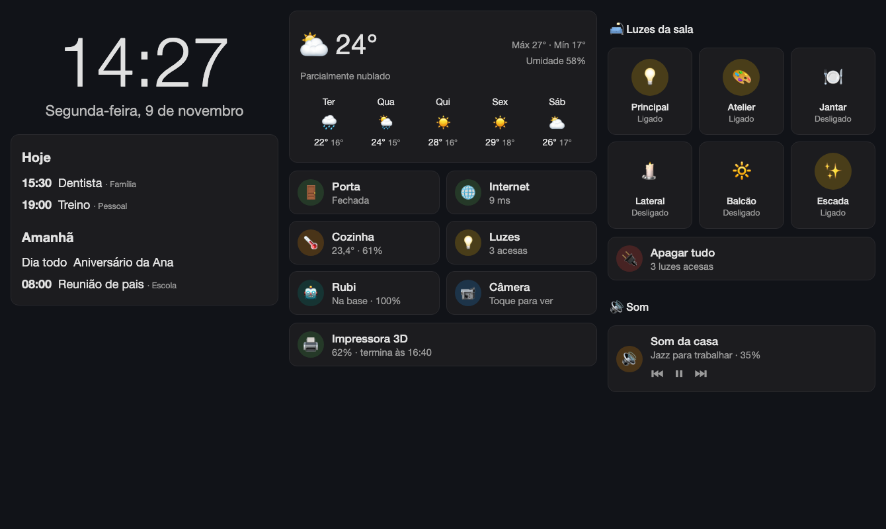
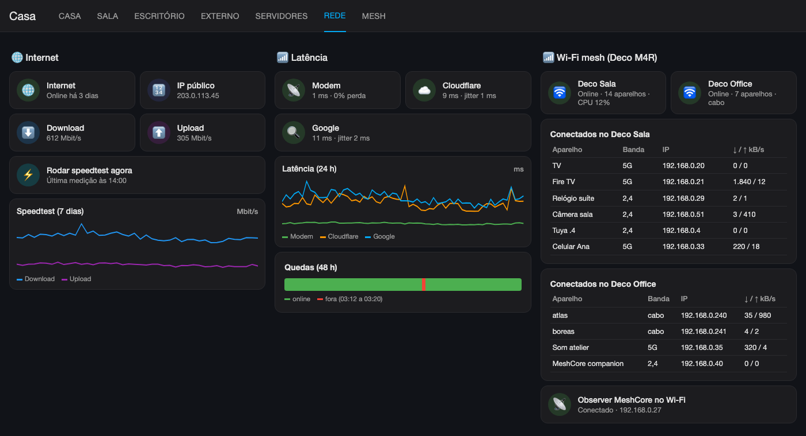

# Smart home with Home Assistant

🇺🇸 English · 🇧🇷 [Português](PT-BR/README.md)

A guide to how I built the Home Assistant setup at home: Docker install, integrations, dashboards (including an Echo Show style tablet dashboard), network monitoring, MeshCore and a Telegram bot with alerts and commands.

The goal is that someone else can follow the steps and build something similar.

**Server names, IPs (192.168.0.0/24 network), domain (`example.com`), keys and IDs are fictitious.** The structure, the integrations and the code are real. Replace them with your own values before you run the scripts.

The house is in Brazil, so entity IDs, script names, dashboard labels and bot messages are in Portuguese. This guide explains what each one means.

Start with the [inventory](docs/00-inventory.md): what is on the network and what was integrated.

More examples in [Dashboards](docs/08-dashboards.md). The images are mockups with fictitious data.

## What is here

| Folder | Content |
|---|---|
| `docs/` | Step by step guides, in the order the work was done |
| `docs/img/` | Example images of the dashboards |
| `PT-BR/` | The same guide in Brazilian Portuguese |
| `scripts/` | Python scripts that create integrations, rename entities and generate dashboards and automations through the API |
| `config/` | Snippets of `configuration.yaml`, the dashboard theme and the `compose.yaml` |

## Guide

0. [Inventory](docs/00-inventory.md): devices, integrations, sensors, automations and dashboards.
1. [Installation](docs/01-installation.md): Docker on ZimaOS/CasaOS, Traefik reverse proxy and first access.
2. [API access](docs/02-api-and-scripts.md): token, WebSocket, REST and how to run the scripts.
3. [Integrations](docs/03-integrations.md): Tuya, Cast, OctoPrint, servers, Pi-hole, Plex, Google, backup, Marketplace.
4. [Energy](docs/04-energy.md): consumption and cost of a Tuya smart plug, with imported history.
5. [Network](docs/05-network.md): internet (ping, speedtest, public IP) and TP-Link Deco Wi-Fi mesh.
6. [MeshCore](docs/06-meshcore.md): LoRa companion, repeater and public CoreScope data.
7. [Template sensors](docs/07-template-sensors.md): agenda, rain coming, night log, mesh messages.
8. [Dashboards](docs/08-dashboards.md): main dashboard with 7 tabs and the "Central" tablet dashboard.
9. [Telegram bot](docs/09-telegram.md): bot creation, alerts, buttons and commands.
10. [Gotchas](docs/10-gotchas.md): errors that showed up and how I fixed them.

## Environment

| Item | My setup |
|---|---|
| Server | `atlas`, ZimaOS (CasaOS), static IP 192.168.0.240 |
| Home Assistant | Container `ghcr.io/home-assistant/home-assistant:stable` (2026.11) |
| Access | `https://ha.example.com` through Traefik, LAN and Tailscale only |
| Second server | `boreas`, Ubuntu, 192.168.0.241 (Glances, Docker for tests) |
| Network | ISP modem 192.168.0.1 + 2 TP-Link Deco M4R (192.168.0.10 and .13) |

## Rules I followed

- Passwords and tokens are typed only in the HA interface, never pasted in a chat, script or repository.
- The API token lives in a file with mode 700, outside the config folder.
- Before changing `configuration.yaml` or `automations.yaml`, I make a `.bak-<topic>` copy.
- Every script has a version in its header, and the version goes up on every change.
- HA is never exposed directly to the internet: remote access goes through Tailscale.
