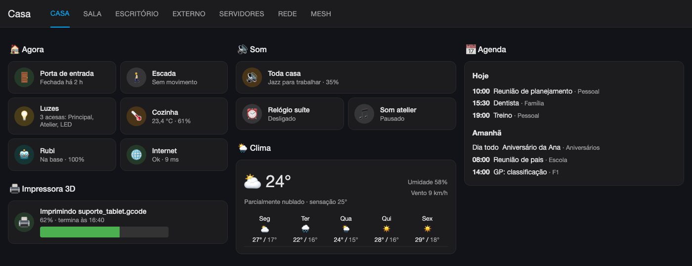
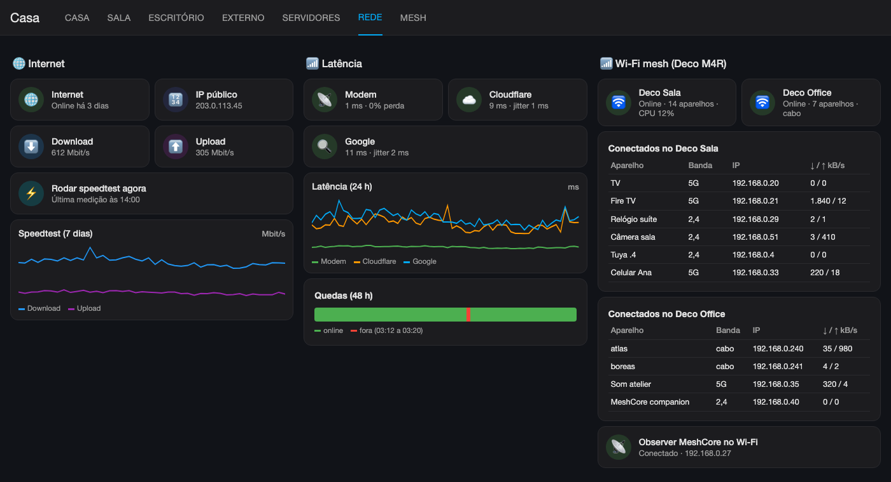
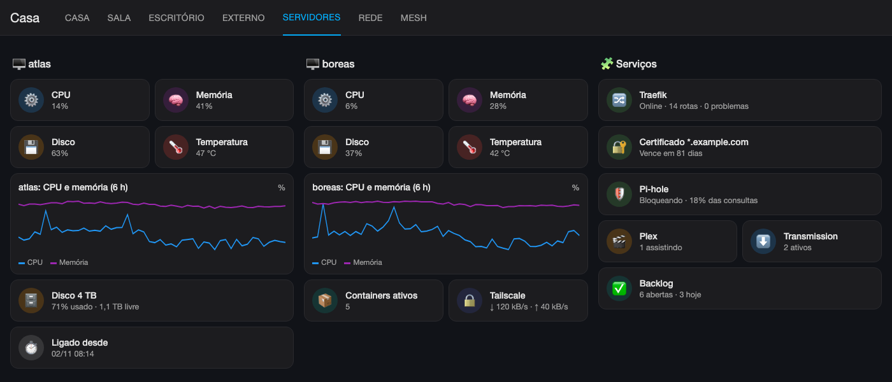
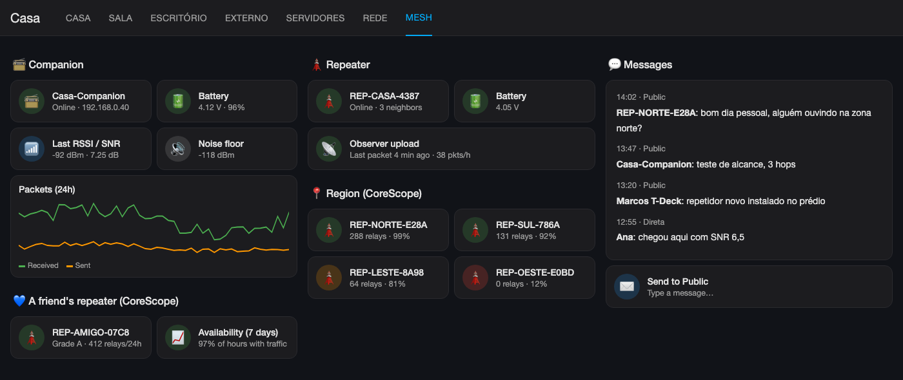
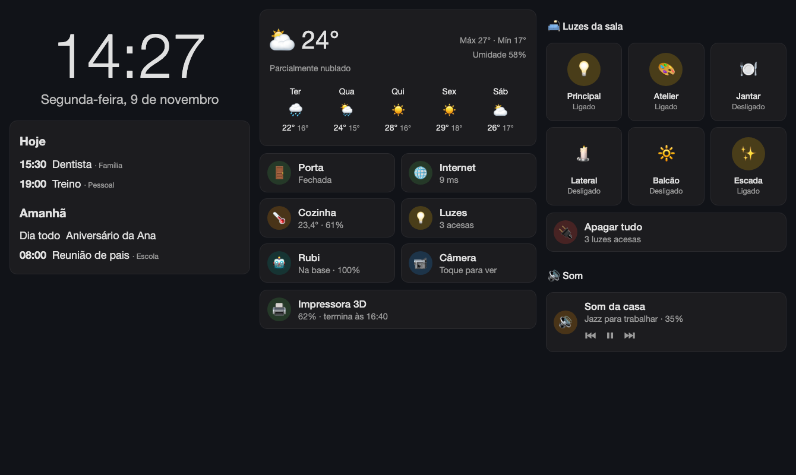

# 8. Dashboards

Both dashboards are generated by a Python script. The script builds the Lovelace JSON and saves it with `lovelace/config/save`. That way the whole dashboard is under version control. **Do not edit it in the interface**: the next run of the script overwrites the changes.

```bash
# first time (creates the dashboard)
{ cat ../ha_token; echo; python3 painel_casa.py --create; } | docker exec -i homeassistant python3 -c "$(cat ha_ws.py)"
# afterwards (update only)
{ cat ../ha_token; echo; python3 painel_casa.py; } | docker exec -i homeassistant python3 -c "$(cat ha_ws.py)"
```

Requirements (Marketplace): Mushroom, mini-graph-card and card-mod.

## 8.1 "Casa" dashboard (`painel-casa`, `painel_casa.py`)

The tabs use the `sections` view type:

| Tab | Content |
|---|---|
| Casa (home) | "Agora" (now: door, stairs motion, lights on), 3D printer, audio (whole house, bedroom, atelier), weather, agenda (`calendar` listWeek) |
| Sala (living room) | Camera, environment (temperature and humidity), lights, IR remote (scenes), Rubi vacuum with pause, resume and stop buttons |
| Escritório (office) | Desk setup (plug, power, consumption and cost, price per kWh), Stacklog, lights, 3D printer, monthly consumption history |
| Externo (outside) | Backyard lights, front door (state and battery), weather |
| Servidores (servers) | atlas and boreas (CPU, memory, disk, network), Traefik, Pi-hole, Plex, Transmission |
| Rede (network) | Internet (status, public IP, speedtest), 24 h latency, 48 h outages, Decos with their client lists, traffic |
| Mesh | Companion, repeater, observer, messages, Public channel, community nodes (CoreScope). Kept in English to share with the community |

Script tips:

- The helpers `tpl()`, `tile()`, `luz()`, `graf()` and `sec()` avoid repeating JSON.
- Cards used in more than one tab must be defined **before** the first tab that uses them, otherwise you get a `NameError`.
- Before publishing, check that the entities exist and render the templates with `/api/template`.

The client list of each Deco is a markdown card that loops over the `device_tracker.wifi_*` entities with `attributes.deco_device == 'Sala'`.

### Examples

The images are mockups with fictitious data, reproducing the layout and the cards of each tab.

**Casa tab**



**Rede (network) tab**



**Servidores (servers) tab**



**Mesh tab**



## 8.2 "Central" tablet dashboard (`painel-tablet`, `painel_tablet.py`)

A single screen dashboard, Echo Show style, made for a 10 inch Android tablet in landscape, in the living room. The view type is `panel`, with a `horizontal-stack` of 3 columns, and it uses the dark theme `Central escuro`:

| Column 1 | Column 2 | Column 3 |
|---|---|---|
| Large clock (Mushroom template, 78 px font via card-mod) and the full date in Portuguese | 4 day daily forecast (`weather-forecast`) | Living room lights (6 buttons, tap toggles, long press opens details) |
| Today's agenda (up to 4 events) and tomorrow's (up to 3), with "+N eventos" when there are more | 2x3 status grid: door, internet, kitchen, lights on, Rubi, camera | "Apagar tudo" (all off), with confirmation |
| | 3D printer and Plex, shown only while in use (`conditional`) | Whole house audio (`media_player.toda_casa`) |



### Dark theme for this dashboard only

The theme is in [`config/themes/central.yaml`](../config/themes/central.yaml). Copy it to `/config/themes/` (`configuration.yaml` needs `frontend: themes: !include_dir_merge_named themes`) and run the `frontend.reload_themes` action. The view uses the theme with `theme: Central escuro`, so the rest of HA keeps the normal theme.

The colors are at the top level of the theme, without `modes:`. That way the view is always dark, even with the phone or tablet in light mode.

### Design for the real tablet screen

The 10 inch tablet has 2000x1200 pixels, but with a density of 2 the browser sees about **1000x600 points**. After the Android status bar, the navigation bar, the HA header and the collapsed sidebar, about **940x470** are left.

The first attempt used the `sections` view, which looks good on a computer. On the tablet only 2 columns fit: each column needs at least 320 px, and the third one (lights and audio) ended up below the screen.

The final version uses:

- a `panel` view with a `horizontal-stack`: the 3 columns always split the width evenly, on any screen;
- `stack-card-gap: 10px` in the theme, for the space between cards;
- border and rounded corners applied to each card with card-mod (`border-radius: 14px !important`), because the `panel` view resets both;
- smaller fonts and less inner padding in the cards, so text does not get cut in 300 px columns;
- a maximum number of agenda events, so it does not overflow the screen height.

To test on a computer, open the dashboard with the window at 1000x525 (in Chrome: DevTools > device mode) or use a headless browser with `device_scale_factor=2`.

### Mushroom 5 and card-mod

Mushroom 5 rebuilt its cards on top of HA's own `ha-tile-info` and `ha-tile-icon`. That is why the old variables (`--card-primary-font-size`) no longer work on template cards:

- **Font:** use `--ha-tile-info-primary-font-size`, `--ha-tile-info-secondary-font-size` and the `*-line-height` variables. They must be set **on `ha-tile-info` itself**, because the `.vertical.fixed-info-height` class overrides the value inherited from `ha-card`. Without that, the large clock gets cut.
- **Circle behind the icon:** the template card does not draw it. It is created with card-mod, reaching into the icon's shadow DOM:

```yaml
card_mod:
  style:
    .: |
      ha-tile-info { --ha-tile-info-primary-font-size: 17px; --ha-tile-info-secondary-font-size: 14.5px; }
    ha-tile-icon$: |
      .container { background: color-mix(in srgb, var(--tile-icon-color) 22%, transparent); }
```

- **Audio off:** on the media card, `collapsible_controls: true` hides the empty volume bar.

To use it on the tablet:

1. Create an HA user just for the tablet, without admin rights.
2. Open `https://ha.example.com/painel-tablet/central` in the browser or in the HA app.
3. In that user's profile, choose the language you want. The weather forecast and states ("On", "Rainy") follow the user's language.
4. Pending: screensaver with photos and kiosk mode with Fully Kiosk Browser (screen always on, no browser bar). The HA top bar does not take the view theme; it goes away in kiosk mode.

Tips:

- The clock is a template with `now()`: HA updates it every minute.
- Weekday and month names are Portuguese lists inside the template, because `strftime` outputs English.
- To show numbers without decimals, use `| float(0) | int`. Example: the Rubi battery showed as "100.0%".
